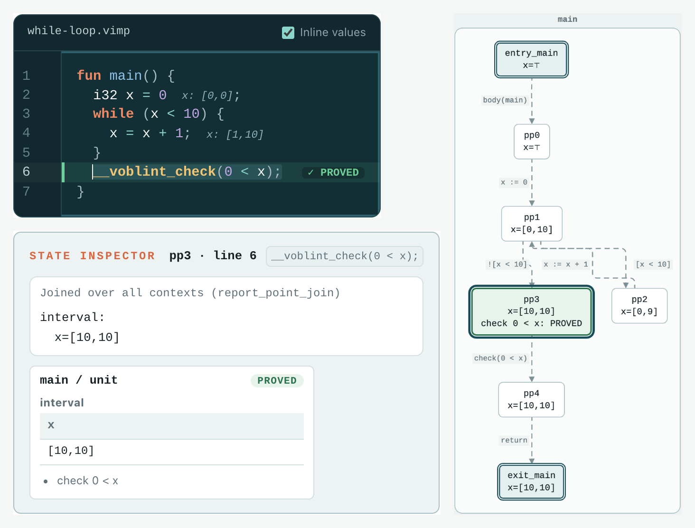
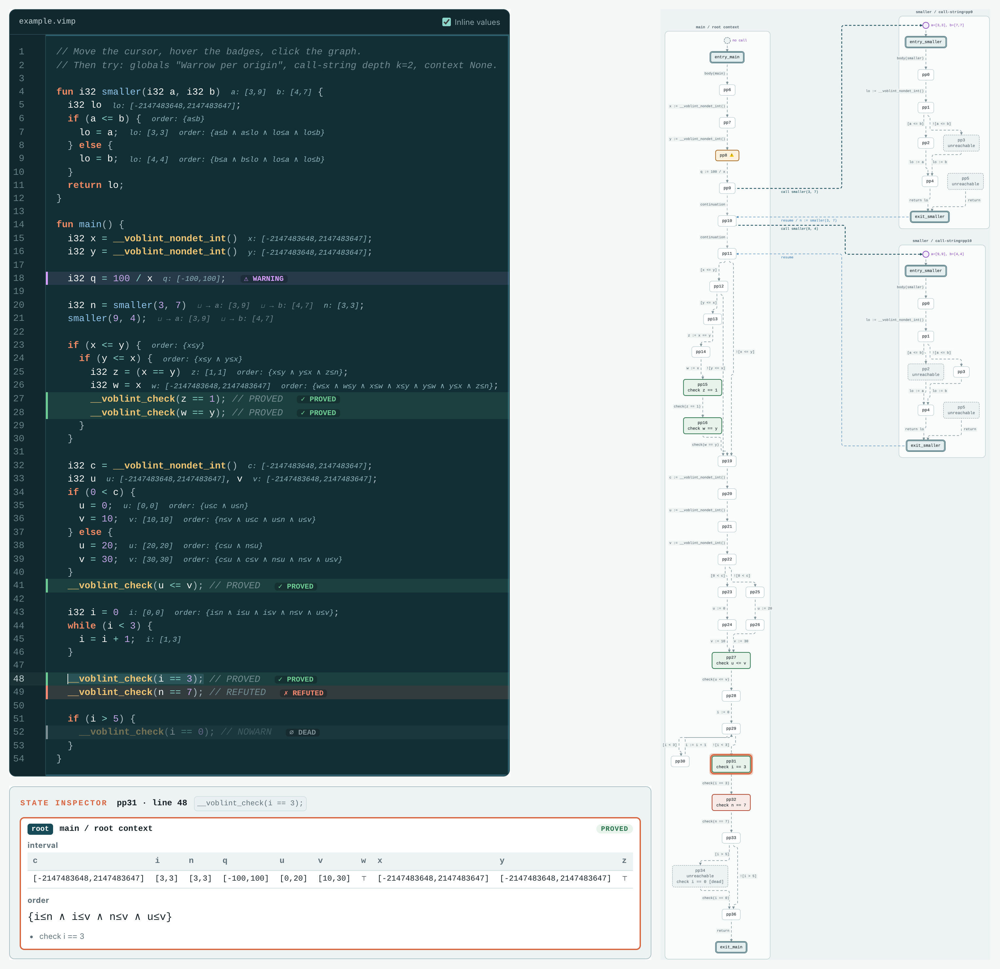
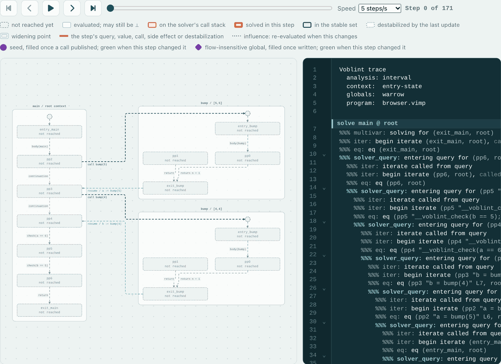
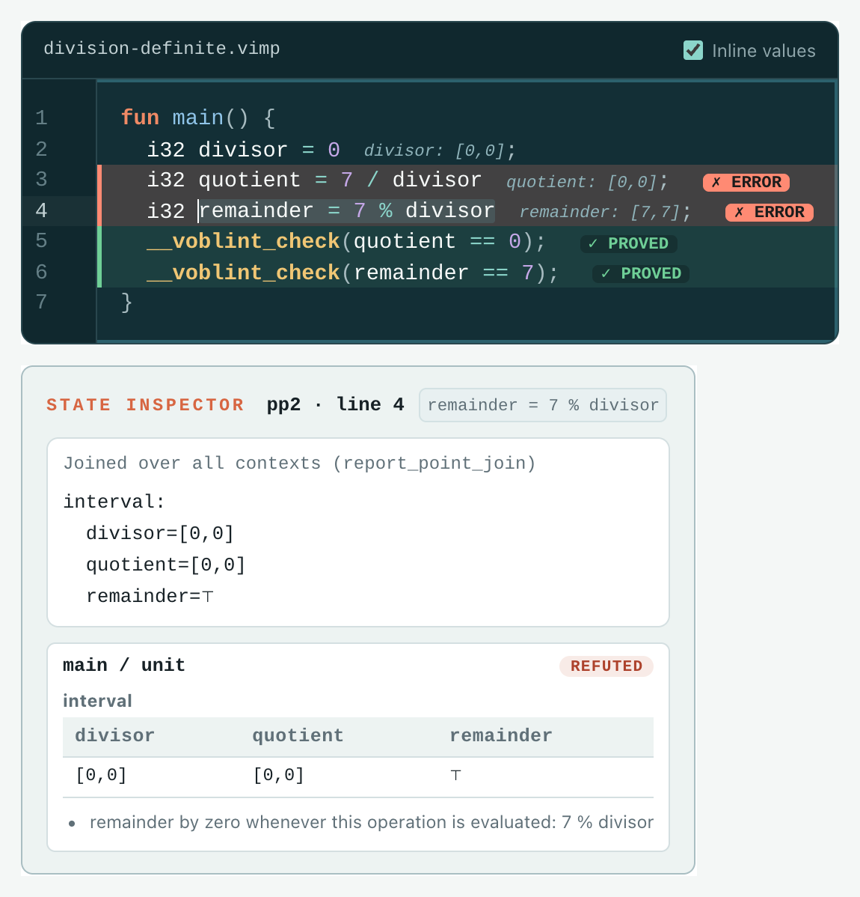
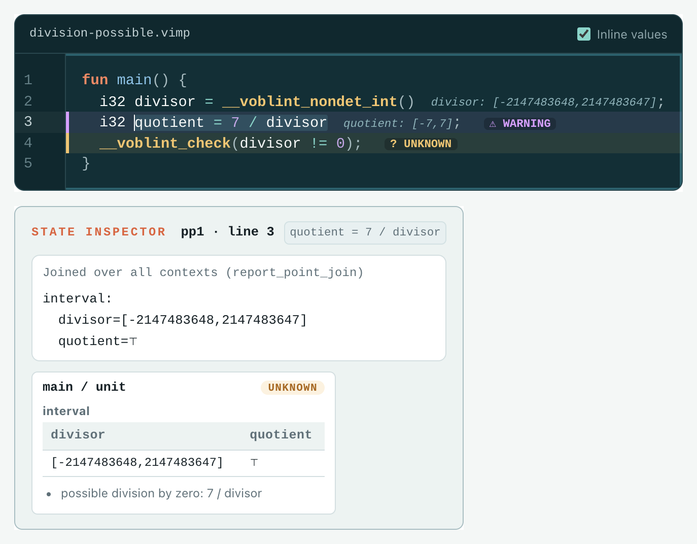
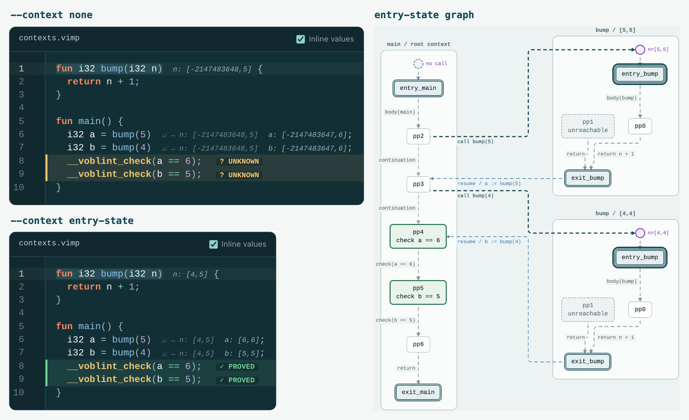

# Voblint

> **A Verified Goblint-Style Static Analysis Pipeline in Isabelle/HOL**
>
> Master's thesis. Manuel Lerchner, supervised by [@AlexandraGrass](https://github.com/AlexandraGrass)

[](https://github.com/ManuelLerchner/Voblint-Verification-Master-Thesis/actions/workflows/ci.yml)
[](https://deepwiki.com/ManuelLerchner/Voblint-Verification-Master-Thesis)

[](https://doi.org/10.5281/zenodo.23260696)

## What is verified?

Voblint proves end-to-end soundness of its executable analyzer. Whenever
`run_voblint` returns a report, every configuration a run of the program reaches
is simulated at a CFG node, its store is collected there, some state the report
holds there describes it, and every definite verdict there holds for it.

```math
\underbrace{(\mathit{main}, s_0, [\,]) \to_p^{*} (r, s, \mathit{fs})}_{\text{run of the program}}
\;\Longrightarrow\;
\exists v.\;
\underbrace{(r, s, \mathit{fs}) \approx v}_{\text{simulated at a node}}
\;\wedge\;
\underbrace{s \in \mathcal{C}(v)}_{\text{collecting semantics}}
\;\wedge\;
\underbrace{s \in \gamma_{\mathit{res}}(v)}_{\text{analysis soundness}}
\;\wedge\;
\underbrace{s \models \mathit{verdicts}_{\mathit{res}}(v)}_{\text{verdict soundness}}
```

Here $`\gamma_{\mathit{res}}(v)`$ stands for the stores some state the report
lists at $v$ describes, and $`s \models \mathit{verdicts}_{\mathit{res}}(v)`$ for
"every `PROVED` check at $v$ is true in $s$, every `REFUTED` one false, $v$ is not
`DEAD`, and if $v$ is `SAFE` every arithmetic obligation there holds". These are
README shorthands; the [headline theorem](#the-headline-theorem) gives the
Isabelle statement.

The run is of the program's core form. The parser builds surface VIMP;
elaboration (`elab_ptable`, an Isabelle definition) resolves names to variable
identities, computes every operation at its machine kind and makes every
conversion explicit; `pstep` executes the result. A surface program means the core
semantics of its elaboration. That meaning is part of the adequacy argument, not a
proved transformation.

Each step is an Isabelle theorem:
[`source_reaches_node_collect`](src/Analyses/Shared/Result/Source_Activation_Sound.thy)
(a run is simulated at a node whose collected stores contain its store),
[`report_state_sound`](src/Executable_Surface/CLI/Run_Report.thy) and
[`report_check_sound`](src/Executable_Surface/CLI/Run_Report.thy) (the report
covers every collected store and its verdicts hold there), read at `run_voblint`'s
answer by [`run_voblint_sound`](src/Executable_Surface/CLI/Run_Voblint.thy).
[`run_voblint_source_sound`](src/Executable_Surface/CLI/Run_Voblint.thy)
states the whole chain for every run that returns a report.

The context-indexed sets $\mathcal{A}(v, c)$ (`activation_collect`) split the
collecting semantics by context without loss:
$\mathcal{C}(v) = \bigcup_{c} \mathcal{A}(v, c)$ for each shipped context policy.
[`run_voblint_spine`](src/Executable_Surface/CLI/Run_Voblint.thy) states the chain
through them for any policy that owes this, and
`run_voblint_call_string_chain` and `run_voblint_entry_state_chain` discharge it
for call strings and entry states. The guarantees are one-way: the report may
describe stores that no run reaches.

## What is Voblint?

Voblint is a machine-checked Isabelle/HOL framework for building, running and
verifying interprocedural abstract interpreters, modelled on Goblint's D/G
architecture. It chains verified CFG compilation, activation-trace operational
semantics, executable equation generation, and a vendored verified top-down
solver into one soundness statement about the analyzer's own output.

The solver runs inside Isabelle/HOL and computes an abstract **post-solution**.
With widening and narrowing in play that is not necessarily a least fixpoint.
The end-to-end analyzer corollaries apply to that computed solution rather than to
an externally supplied one; the generic framework theorems below them are
stated for an arbitrary abstract bound.

## Running Voblint

Voblint programs are written in VIMP, a small IMP-style language with
`__voblint_check(cond)` assertions:

```c
fun main() {
    x = 0;
    while (x < 10) {
        x = x + 1;
    }
    __voblint_check(0 < x);
}
```

```text
$ pixi run voblint --analysis interval tests/regression/02-control-flow/precision/02-while_loop.vimp
tests/regression/02-control-flow/precision/02-while_loop.vimp [interval]

Arithmetic diagnostics
None

Assertion checks
Location  Point  Condition  Verdict  State
--------  -----  ---------  -------  -------------------
8:3       pp3    0 < x      PROVED   interval: x=[10,10]
```

The [browser playground](https://manuellerchner.github.io/Voblint-Verification-Master-Thesis/playground.html) runs the same generated analyzer on a program
you edit, with no server involved. Verdicts and value hints appear in the source,
the cursor's statement shows its state in every context, and the solved graph
draws one box per procedure and context. To explore a local program there, add
`--playground`: it opens the playground with the file and the given settings, or
those of its `// PARAM:` header, instead of analyzing it locally.

```bash
pixi run voblint --analysis interval --context entry-state my_program.vimp --playground
```

<p align="center">
  <a href="docs/images/while_loop_cfg.png">
    
  </a>
  <br><sub>The program above in the playground. <a href="https://manuellerchner.github.io/Voblint-Verification-Master-Thesis/playground.html?analysis=interval&amp;globals=warrow&amp;context=none#code=SyvNU8hNzMzT0FSo5lJQyDQ2UqhQsFUwsAZyyjMyc1IVNCoUbBQMDSDyCmDZCgVtBUOQilogjo8vy0_KycwriU_OSE3O1jAAKq_QtOaqBQA">Open this run</a>.</sub>
</p>

<p align="center">
  <a href="docs/images/playground-overview.png">
    
  </a>
  <br><sub>Calls, contexts, a relational domain, verdicts and an arithmetic warning in one run. <a href="https://manuellerchner.github.io/Voblint-Verification-Master-Thesis/playground.html?analysis=interval%2Corder&amp;globals=warrow&amp;context=call-string&amp;k=1">Open this run</a>.</sub>
</p>

`--context none|entry-state|call-string` selects the analysis context,
`--globals` the update rule for side-effected globals, and
`--program-globals flow-sensitive|flow-insensitive` whether a program's globals
travel with each point's state or each live at its own global unknown, read only by
the points that mention it;
both placements carry the same soundness theorem. `pixi run voblint --help`
lists every analyzer flag; `--playground` is an option of the `pixi run voblint`
wrapper. `--graph-snapshot` prints the solved graph as deterministic text and
`--parse-only` checks syntax. [`docs/CLI_DESIGN.md`](docs/CLI_DESIGN.md)
describes the CLI trust boundary and
[`src/Executable_Surface/CLI/README.md`](src/Executable_Surface/CLI/README.md)
how a run becomes a report.

`--trace` also writes the solver's steps to stderr: per call, the context it is
routed to, what the callee's entry reads from its seed, and which publications
restart the caller. `--verbose` lists every step in a Goblint-aligned tracing
vocabulary (`%%% iter: begin iterate ...`; the mapping table in
`docs/CLI_DESIGN.md` records every difference), `--trace-sys iter,side` selects
subsystems, `--format jsonl` emits JSON Lines and `--output FILE` writes to a
file; standard output stays the same. The playground's **run_voblint: call and answer** panel
shows the full (`--verbose`) trace under the call and its answer, colored by step and folded
by query, with downloads of the whole text and of its JSON Lines form. Three layers: the solver
result is the exported computation of proved equations, and the trace calls
inside it come from code equations proved equal to the untraced ones; the trace
is an unverified observation of that computation, through a `code_printing`
mapping of `trace_event` to an OCaml hook that returns unit, swallows
exceptions and never touches solver state, so it cannot feed back; the replay
and animation are an unverified visualization of the trace
([`docs/CLI_DESIGN.md`](docs/CLI_DESIGN.md#solver-trace---trace)).

```bash
pixi run voblint --analysis interval --context entry-state --trace docs/readme-figures/contexts.vimp
```

The playground's **Solve replay** section steps through the same solve on the
graph, with the verbose trace beside it: the value each unknown holds, the seed
each call publishes its entry state into, the stack of open queries and the
edge each query follows backward from the exit, with the stable set,
destabilization cascades, widening points and influence edges drawn on the
graph and the routes and counters below it. One reducer folds the run's JSON
Lines trace into every state it shows.
`node scripts/capture_readme_figures.mjs solve-replay` regenerates the
animation below from the playground.

<p align="center">
  <a href="docs/images/solve-replay.gif">
    
  </a>
  <br><sub>The context example solved step by step. <a href="https://manuellerchner.github.io/Voblint-Verification-Master-Thesis/playground.html?analysis=interval&amp;globals=warrow&amp;context=entry-state#code=SyvNU8g0NlJIKs0t0AAx8jQVqrkUFIpSS0qL8hTyFLQVDK25arm40oAKcxMz8zQg8iCliQq2EH2mmtZQoSSYkAlYKD6-LD8pJzOvJD45IzU5WwOow1bBDKtUEkgKZFAtAA">Open this run</a>.</sub>
</p>

### Arithmetic diagnostics

Every analysis also checks the arithmetic of each evaluated expression against the
solved state before the statement: division and remainder by zero, signed `+`, `-`,
`*` and `/` whose result may leave its kind, signed `%` whose quotient may leave it
(`INT_MIN % -1`), and conversions to a narrower kind that may not fit, including a
returned value converted to the caller's destination and a `min`/`max` result
converted to its destination. An obligation that may fail is a `warning`; one that
fails in every reaching store is an `error`. Safe operations and unreachable points report nothing, and diagnostics
never change the exit code.

<table>
  <tr>
    <td align="center">
      <a href="docs/images/playground-division-definite.png">
        
      </a>
      <br><sub>Definite: errors, while both checks still prove. <a href="https://manuellerchner.github.io/Voblint-Verification-Master-Thesis/playground.html?analysis=interval&amp;globals=warrow&amp;context=none#code=SyvNU8hNzMzT0FSo5lJQyDQ2UkjJLMsszi9SsFUwsIYKFZbml2Sm5pUAxcwV9GEqYLJFqSATUlKLwNKqyNLx8WX5STmZeSXxyRmpydkaCIOApmtiU4FkGNA0oJJaAA">Open</a>.</sub>
    </td>
    <td align="center">
      <a href="docs/images/playground-division-possible.png">
        
      </a>
      <br><sub>Possible: the state cannot exclude zero. <a href="https://manuellerchner.github.io/Voblint-Verification-Master-Thesis/playground.html?analysis=interval&amp;globals=warrow&amp;context=none#code=SyvNU8hNzMzT0FSo5lJQyDQ2UkjJLMsszi9SsFWIjy_LT8rJzCuJz8vPS0ktiQcyNTStoeoKS_NLMlPzSoAKzRX0YdpAsgh9yRmpydkaMBMVbRUMgNprAQ">Open</a>.</sub>
    </td>
  </tr>
</table>

The traversal covers assignments, guards, call arguments, returns, `min`/`max`
and checks, nested arithmetic included, and both operands of `&&` and `||`. It is
a diagnostic policy over VIMP's total expressions: execution still uses
`a / 0 = 0` and `a % 0 = a`, and wraps every result into its kind. "Possible"
means the abstraction cannot exclude the hazard, not that a violating execution
exists; an `error` does not prove its point reachable. The
[arithmetic fixtures](tests/regression/23-arithmetic-diagnostics/README.md) and
[signed-overflow fixtures](tests/regression/27-signed-overflow/README.md) pin the
findings.

### Machine integers

Every VIMP value is a machine integer of some kind (`i8` to `u64`). Every variable
declares its kind C-style: on a `global` line, on a formal, and on locals, declared
anywhere in a body with C's block scoping; a procedure that returns a value declares
its return kind. The parser rejects a name that no declaration in scope introduces.
A local's initializer is an expression or a call (`u8 r = f(n);`); a local declared
without one starts at an arbitrary value of its kind. `(k) e` converts explicitly:

```c
global u8 g;
fun u8 f(u8 n) { return n + 1; }
fun main() {
  g = f(300);
  __voblint_check(g == 45); // PROVED: 300 converts to 44 at u8, then 44 + 1
}
```

Elaboration ([`Core_Exp.thy`](src/Program_Model/VIMP/Core_Exp.thy),
[`Core_Com.thy`](src/Program_Model/VIMP/Core_Com.thy)) resolves every name to a
static identity, computes every operation at its C kind (integer promotion and the
usual arithmetic conversions), and inserts a conversion wherever a value is written
to a place of another kind. Every result wraps into its kind, signed overflow
included (the `-fwrapv` reading, which C leaves undefined); the signed-overflow
diagnostics report where a C program could overflow. How a domain treats a possible
signed overflow is a run option, Goblint's `sem.int.signed_overflow`: `assume_top`
(the default) or `assume_wraparound`; the theorems hold under both. A literal
outside `i64` is rejected. The
[machine-kind fixtures](tests/regression/26-machine-kinds/README.md) have the
examples.

Three steps before Isabelle are trusted: the parser's block-scope resolution (a
declaration that shadows a name gets a fresh name, and a name without a
declaration in scope is rejected), the rewriting of a declaration
without initializer into `x = __voblint_nondet_int()`, and the source positions it
records.

## What Voblint proves

For every selection of analyses, globals rule, context policy, placement of
program globals and overflow policy, the report `run_voblint` returns is sound for
every execution of the program: whenever an execution reaches a program point, some
state the report holds there describes its store, and every `PROVED` or `REFUTED`
verdict there is correct for it. The theorems are stated about the same
`run_voblint` that is exported to OCaml and runs in the CLI and the playground.

"Every execution" is made precise by an activation-trace collecting semantics.
A [`valid_activation_trace`](src/Program_Model/CFG/Collecting/Activation_Trace_Def.thy)
records one procedure activation's view of a run, and
[`node_collect`](src/Program_Model/CFG/Collecting/Activation_Trace_Collect.thy) gathers
every store such traces hold at each CFG node, adapting thread-modular local traces
(see [Foundations](#foundations)) from threads to procedure activations. The public
theorems read it as `reaching ds p v`, the stores that reach node `v` of the
elaborated graph `elab_cfg p ds` from `init_stores` (globals zero, every value in its
kind).

### The headline theorem

[`run_voblint_source_sound`](src/Executable_Surface/CLI/Run_Voblint.thy) relates any
finite run of the program to the report:

```isabelle
theorem run_voblint_source_sound:
  assumes run: "run_voblint conf ds p = Analysed res"
    and s0: "s0 ∈ init_stores (kenv_of ds)"
    and exec: "star (pstep (kenv_of ds) (elab_ptable p ds))
                 (main_body (elab_ptable p ds), s0, []) (residual, s, frs)"
  shows "∃v stk. elab_ptable p ds, elab_cfg p ds, prog_main_name
                    ⊢ (residual, s, frs) ≈ (v, s, stk)
           ∧ s ∈ reaching ds p v
           ∧ (∃d. Lifted d ∈ report_states_at res v
                  ∧ s ∈ mcp.act_gamma ds (activation_of (conf_analyses conf)) d)
           ∧ ¬ DEAD res v
           ∧ (∀c. PROVED res v c ⟶ truthy (eval c s))
           ∧ (∀c. REFUTED res v c ⟶ ¬ truthy (eval c s))
           ∧ (SAFE res v ⟶ (∀ob ∈ obligations_at ds p v. s ⊨ ob))"
```

| Premise | Meaning |
| --- | --- |
| `run` | `run_voblint` accepted the configuration and the program, and its solve finished. |
| `s0` | Initial store: globals start at `0`, every identity holds a value of its kind. |
| `exec` | Any finite execution prefix of the elaborated program from `main`; the program need not terminate. |

| Conclusion | Guarantee |
| --- | --- |
| `… ≈ (v, s, stk)` | The reached configuration is simulated at CFG node `v` by the compiler's simulation relation `csim`, with the same store. |
| `s ∈ reaching ds p v` | A valid activation trace reaches `v` with store `s`. |
| `∃d. …` | Some state the report holds at `v` describes `s`, through the concretization of the activated analyses. |
| `¬ DEAD res v` | `v` is not reported dead. |
| `PROVED`, `REFUTED` | Every definite verdict at `v` holds for `s`. |
| `SAFE` | If `v` has no arithmetic diagnostic, every obligation decided there holds of `s`. |

`ds` are the kind declarations the parser hands over; `conf` names a nonempty list of
distinct analyses among Interval, Congruence, Int (at a refinement mode), Order,
Sign and Parity, run together, one of the globals rules, a context policy (call
strings of any length, length `0` being context-insensitive, or entry states), the
placement of program globals, and the signed-overflow policy.

[`run_voblint_sound`](src/Executable_Surface/CLI/Run_Voblint.thy) states the same
guarantees at a node, for every store in `reaching ds p v`, without a run.

### Checks, dead code and arithmetic

Results in the same theory specialise the guarantee to what the report shows:

- [`run_voblint_check_sound`](src/Executable_Surface/CLI/Run_Voblint.thy): when an
  execution is about to run a check, the report lists a row under that check's label
  at a node reached with the current store, the row is not `Dead`, and a definite
  verdict is correct. `run_voblint_labelled_check_sound` adds that, when no two rows
  share a label, every row carrying the label is that row.
- [`run_voblint_dead_unreached`](src/Executable_Surface/CLI/Run_Voblint.thy): no
  store reaches a `DEAD` point.
- [`run_voblint_arithmetic_safe`](src/Executable_Surface/CLI/Run_Voblint.thy): at a
  point with no arithmetic diagnostic, every obligation of every expression an edge
  or call there evaluates holds in every store that reaches it, and every value
  returned there fits the kind a caller converts it to.
  `run_voblint_no_signed_overflow`, `run_voblint_no_remainder_overflow` and
  `run_voblint_no_conversion_overflow` read it for signed operations, signed
  remainders and conversions.
- [`run_voblint_arithmetic_refuted`](src/Executable_Surface/CLI/Run_Voblint.thy): the
  obligation of an `error` fails in every store that reaches its point.

<details>
<summary>Exact statements</summary>

```isabelle
theorem run_voblint_report_contract:
  assumes "run_voblint conf ds p = Analysed res"
  shows "valid_activation (conf_analyses conf)" and "wf_program_compile_input_exec p"
    and "report_config res = conf" and "report_cfg res = elab_cfg p ds"
```

```isabelle
theorem run_voblint_check_sound:
  assumes run: "run_voblint conf ds p = Analysed res"
    and s0: "s0 ∈ init_stores (kenv_of ds)"
    and exec: "star (pstep (kenv_of ds) (elab_ptable p ds))
                 (main_body (elab_ptable p ds), s0, []) (residual, s, frs)"
    and chk: "next_check residual = Some (l, e)"
  shows "∃c ∈ set (report_checks res). check_label c = l ∧ check_exp c = e
           ∧ s ∈ reaching ds p (check_point c)
           ∧ check_verdict c ≠ Dead
           ∧ (check_verdict c = Decided Check_Proved ⟶ truthy (eval e s))
           ∧ (check_verdict c = Decided Check_Refuted ⟶ ¬ truthy (eval e s))"
```

```isabelle
corollary run_voblint_dead_unreached:
  "run_voblint conf ds p = Analysed res ⟹ DEAD res v ⟹ reaching ds p v = {}"
```

```isabelle
theorem run_voblint_arithmetic_refuted:
  assumes run: "run_voblint conf ds p = Analysed res"
    and d: "d ∈ set (report_diagnostics res)" and r: "diagnostic_verdict d = Check_Refuted"
    and s: "s ∈ reaching ds p (diagnostic_point d)"
  shows "¬ s ⊨ diagnostic_obligation d"
```

</details>

### Limits

The result is partial correctness. `run_voblint` runs the executable solver,
which answers only where the solve terminates, so the theorems need no
termination premise; nothing proves that the solve terminates for every program,
and where it does not, the analyzer gives no answer. Neither `PROVED` nor
`REFUTED` establishes that its point is reachable, so `REFUTED` is not a verified
counterexample. `DEAD` is the only reachability claim: no covered execution
reaches the point. The converse does not hold: a point no execution reaches need
not be `DEAD`.

| Covered by the proof | Outside the proof |
| --- | --- |
| Execution of the elaborated core program (`pstep` on `elab_ptable p ds`) | Solver termination for arbitrary programs |
| Compilation to the procedure-aware CFG (`elab_cfg`) and its simulation | Lexing, parsing, block-scope resolution, and the rewriting of a declaration without initializer |
| Equation generation and the computed post-solution | Isabelle code generation, the OCaml compiler and runtime |
| The report's states, check rows under their labels, arithmetic safety at quiet points, failing obligations at errors | That a check's label is its source position; diagnostic positions; rendered graphs and state strings; the playground |
| | That elaboration and `pstep` model C's meaning of the source (an adequacy argument, not a theorem) |
| | Completeness and precision |

[`Example_Non_Vacuity`](src/Examples/Capstone/Example_Non_Vacuity.thy) evaluates a
concrete answer and discharges the headline theorem's premises for it, so the theorem
is not vacuous. [`docs/THEOREM_MAP.md`](docs/THEOREM_MAP.md) lists the lower-level
statements.

## Notation

<!-- notation:begin -->
<!-- Generated by thesis/tools/notation.py from thesis/shared/notation.toml. -->

Theorem statements use a few symbols the theories declare. Each name links to its declaration.

| Symbol | Reads as | Isabelle | Meaning |
| --- | --- | --- | --- |
| κ,Π ⊢ c →<sub>p</sub> c' / κ,Π ⊢ c →<sub>p</sub><sup>&#42;</sup> c' | _c_ steps to _c′_ | [`pstep`](https://manuellerchner.github.io/Voblint-Verification-Master-Thesis/Voblint/Voblint_VIMP/VIMP_Semantics.html#VIMP_Semantics.pstep%7Cconst) / [`psteps`](https://manuellerchner.github.io/Voblint-Verification-Master-Thesis/Voblint/Voblint_VIMP/VIMP_Semantics.html#VIMP_Semantics.psteps%7Cconst) | one small step of a core VIMP configuration (command, store, frame stack) under kind environment _κ_ and procedure table _Π_; every value it writes is converted to its destination's kind; the starred arrow is its reflexive-transitive closure |
| Π,g,p ⊢ c ≈ c' | _c_ is matched with _c′_ | [`csim`](https://manuellerchner.github.io/Voblint-Verification-Master-Thesis/Voblint/Voblint_Compile/Simulation_Relation.html#Simulation_Relation.csim%7Cconst) | the compiler's simulation relation between a source configuration _c_ whose outermost activation runs procedure _p_ and a configuration _c′_ of the compiled graph _g_ |
| κ | the kind environment | [`kenv_of`](https://manuellerchner.github.io/Voblint-Verification-Master-Thesis/Voblint/Voblint_VIMP/Core_Com.html#Core_Com.kenv_of%7Cconst) | the machine kind of every variable identity; a program supplies it from its kind declarations, an undeclared identity being I32, and the theorems take it as a parameter |
| 𝒯<sub>κ,g,S</sub> | the valid activation traces of _g_ from _S_ | [`valid_activation_trace`](https://manuellerchner.github.io/Voblint-Verification-Master-Thesis/Voblint/Voblint_CFG/Activation_Trace_Def.html#Activation_Trace_Def.valid_activation_trace%7Cconst) | the activation traces of graph _g_ from initial stores _S_ |
| 𝒞<sub>κ,g,S</sub> v | the stores collected at _v_ | [`node_collect`](https://manuellerchner.github.io/Voblint-Verification-Master-Thesis/Voblint/Voblint_CFG/Activation_Trace_Collect.html#Activation_Trace_Collect.node_collect%7Cconst) | the stores valid activation traces reach at node _v_ |
| 𝒜<sub>κ,adm,c₀,g,S</sub> v c | the stores collected at _v_ in context _c_ | [`activation_collect`](https://manuellerchner.github.io/Voblint-Verification-Master-Thesis/Voblint/Voblint_CFG/Activation_Trace_Context.html#Activation_Trace_Context.activation_collect%7Cconst) | the stores valid activation traces carrying context _c_ reach at node _v_; _adm_ admits callee contexts and the root runs in _c₀_ |
| carries t c<br>In `gactivation_coverage`, short for gactivation&#95;context&#95;rel adm c<sub>0</sub> g | _t_ carries context _c_ | [`carries`](https://manuellerchner.github.io/Voblint-Verification-Master-Thesis/Voblint/Voblint_CFG/Activation_Trace_Abstract.html#Activation_Trace_Abstract.gactivation_coverage.carries%7Cconst) | the context relation of the locale's policy, between a valid activation trace and the contexts it may run in |

<!-- notation:end -->

## Reading a result

Each figure is a playground run; the link under it opens the same program and
settings.

<table>
  <tr>
    <td align="center">
      <a href="docs/images/playground-contexts.png">
        
      </a>
      <br><b>Context sensitivity, Interval</b>
      <br><sub>Without contexts, <code>bump(5)</code> and <code>bump(4)</code> share one state for <code>n</code>, so neither result is exact and both checks are UNKNOWN. <code>--context entry-state</code> keeps a separate abstract state per distinct <em>abstract</em> argument, so both checks prove, and the graph draws each context as its own box: <code>[5,5]</code> and <code>[4,4]</code>, instead of one box holding their join.</sub>
      <br><sub><a href="https://manuellerchner.github.io/Voblint-Verification-Master-Thesis/playground.html?analysis=interval&amp;globals=warrow&amp;context=none#code=SyvNU8g0NlJIKs0t0AAx8jQVqrkUFIpSS0qL8hTyFLQVDK25arm40oAKcxMz8zQg8iCliQq2EH2mmtZQoSSYkAlYKD6-LD8pJzOvJD45IzU5WwOow1bBDKtUEkgKZFAtAA">Open without contexts</a> &middot; <a href="https://manuellerchner.github.io/Voblint-Verification-Master-Thesis/playground.html?analysis=interval&amp;globals=warrow&amp;context=entry-state#code=SyvNU8g0NlJIKs0t0AAx8jQVqrkUFIpSS0qL8hTyFLQVDK25arm40oAKcxMz8zQg8iCliQq2EH2mmtZQoSSYkAlYKD6-LD8pJzOvJD45IzU5WwOow1bBDKtUEkgKZFAtAA">open with entry-state contexts</a></sub>
    </td>
  </tr>
</table>

## The generic D/G framework

Analyses are factored the way Goblint factors them: **D** holds the abstract facts
attached to program points, **G** the information published and consumed across
points. The framework's interface is
[`gdg_spec`](src/Abstract_Interpreter/Framework/Spec/DG_Spec.thy), the Isabelle
counterpart of Goblint's
[`Spec`](https://github.com/goblint/analyzer/blob/1ab59c9c4d9859e9135885d3c9a9aa1a8f3b677e/src/framework/analyses.ml#L168-L263)
(transfer, entry, combine and communication). Equation generation with context
routing, solver integration and the lifting to source-level soundness are proved
once, for any `gdg_spec` with a
[`ganalysis_contract`](src/Abstract_Interpreter/Framework/Spec/DG_Spec_Sound.thy)
relating it to concrete stores; see
[`src/Abstract_Interpreter/Framework/README.md`](src/Abstract_Interpreter/Framework/README.md).

Every analysis selectable through `run_voblint` enters through a smaller
interface, a [`glocal_spec`](src/Abstract_Interpreter/Framework/Cooperation/MCP_Spec.thy):
one transfer per edge kind plus entry and combine, over local state only, with
the soundness condition `gsound_local_spec`. `dg_spec_of` lifts it to a `gdg_spec`,
and `dg_spec_of_contract` supplies the contract. The activated analyses run as one
state, one field each, as in Goblint's MCP
([`MCP_Registry`](src/Abstract_Interpreter/Framework/Cooperation/MCP_Registry.thy),
[`MCP_Carrier`](src/Executable_Surface/CLI/MCP_Carrier.thy)), and answer each
other's queries. With flow-insensitive program globals,
[`gkeyed_split_spec`](src/Abstract_Interpreter/Framework/Spec/DG_Keyed_Split_Spec.thy)
wraps that specification so each edge reads only the globals its expressions
mention and publishes only the globals it may assign, each at its own unknown,
and `gkeyed_split_contract` carries the contract over.

A numeric domain enters as an instance of the class
[`kind_int_domain`](src/Analyses/Nonrelational/Nonrelational_Domain.thy): values at
a machine kind with kind-aware arithmetic, conversion, comparison, backward
refinement and top, each with its soundness assumption. The non-relational
transfer [`nonrel_spec`](src/Analyses/Nonrelational/Nonrelational_Transfer.thy) is
written once over any such domain and proved sound once (`nonrel_spec_sound`); its
executable carrier is `nonrel_exec_spec`
([`Nonrelational_Exec`](src/Analyses/Nonrelational/Nonrelational_Exec.thy)). Sign,
Interval, Parity, Congruence and the Interval-Congruence product `int_tuple` are
instances. The relational Order analysis writes its `glocal_spec` by hand
([`ord_spec`](src/Analyses/Order/Order_Analysis.thy)). Deriving transfer functions
from certified value operations follows Nipkow's Isabelle abstract interpreter (see
[Foundations](#foundations)).

## Building

Requirements: **Isabelle2025-2**, an **[AFP](https://www.isa-afp.org/)** checkout,
**[pixi](https://pixi.sh/)**, and OCaml via opam for the CLI.

```bash
./scripts/setup.sh                             # pixi, OCaml and developer tooling
pixi run vendor-init                           # fetch the TD solver submodule
AFP=/path/to/afp/thys pixi run isabelle-build  # check the formalization
```

On a fresh clone without parent heaps, run `pixi run isabelle-bootstrap` first,
with the same `AFP` setting.
`pixi run isar-check` checks ROOT entries, unfinished proofs, theory syntax and
formatting with isar-tools, without Isabelle or the AFP. `pixi task list` lists
everything else.

> The vendored solver is pinned to a private fork of
> [stilscher/td-verification](https://github.com/stilscher/td-verification); CI
> needs a `SUBMODULES_TOKEN` secret to clone it. Making that fork public is the
> outstanding step for a fully reproducible artifact.

## Foundations

- **Goblint** ([GitHub](https://github.com/goblint/analyzer)): modular interprocedural abstract interpretation and the D/G architecture.
- **Abstract Interpretation of Annotated Commands** ([ITP 2012](https://doi.org/10.1007/978-3-642-32347-8_9)): reusable abstract interpretation in Isabelle/HOL.
- **The Top-Down Solver Verified** ([CAV 2024](https://doi.org/10.1007/978-3-031-65627-9_15)): the vendored executable verified solver.
- **Mixed Flow-Sensitive Static Analysis: Engineering Modularity** ([FM 2026](https://doi.org/10.1007/978-3-032-26220-2_22)).
- **Data Race Detection by Digest-Driven Abstract Interpretation** ([arXiv:2511.11055](https://arxiv.org/abs/2511.11055)): thread-modular local-trace semantics of a multithreaded program. Voblint's activation traces (`src/Program_Model/CFG/Collecting/`) adapt its shape to procedure activations of a sequential run.

## Documentation

| Document | Contents |
| --- | --- |
| [`AGENTS.md`](AGENTS.md) | Project contract, style rules, working agreements |
| [`docs/PROOF_OVERVIEW.md`](docs/PROOF_OVERVIEW.md) | Proof architecture and intended claims |
| [`docs/THEOREM_MAP.md`](docs/THEOREM_MAP.md) | Thesis claims mapped to checked Isabelle theorems |
| [`docs/GLOSSARY.md`](docs/GLOSSARY.md) | Terminology and defining layers |
| [`docs/VERIFICATION_CHAIN_AND_TRUST_BOUNDARY.md`](docs/VERIFICATION_CHAIN_AND_TRUST_BOUNDARY.md) | What is proved, what is trusted |
| [`docs/GOBLINT_ALIGNMENT_REGISTER.md`](docs/GOBLINT_ALIGNMENT_REGISTER.md) | Where this formalization differs from upstream Goblint, and why |
| [`docs/ISABELLE_AGENT_NOTES.md`](docs/ISABELLE_AGENT_NOTES.md) | Build commands, agent-assisted development (I/Q, I/R), `./scripts/setup.sh` |
| [`docs/ROADMAP.md`](docs/ROADMAP.md), [`docs/NON_GOALS.md`](docs/NON_GOALS.md) | Scope and priorities |

## License

Voblint is available under the [`BSD-3-Clause`](LICENSE) license. Vendored
dependencies retain their own licenses.
